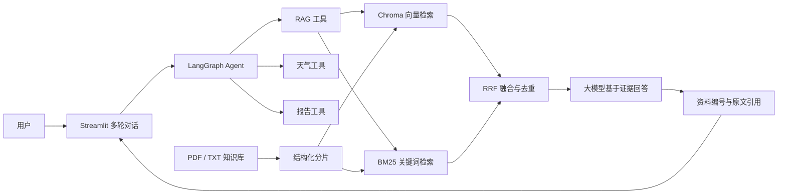

# 智扫通机器人智能客服

一个面向扫地机器人与扫拖一体机器人的 RAG 智能客服项目。系统使用 LangChain/LangGraph 编排 Agent，通过结构化分片、Chroma 向量检索和 BM25 + RRF 混合检索回答产品问题，并在 Streamlit 页面提供多轮对话、原文引用、实时天气和月度报告功能。

## 项目亮点

- **可评测的 RAG**：建立60道人工标注检索题，其中55道可回答、5道无答案，使用 `KeywordHit@3` 评估证据召回。
- **结构化分片**：优先按文档编号切分，保持一条问答或故障处理记录完整，命中率从60.00%提升到89.09%。
- **混合检索实验**：实现中文 BM25、向量检索和加权 RRF 融合，并记录准确率、延迟和实验参数。
- **引用可追溯**：回答使用 `[资料N]` 标注依据，页面可展开查看文件名、页码和检索原文。
- **异常与拒答**：资料不足时明确拒答；工具异常转为友好消息；单轮最多调用5次工具。
- **自动化回归**：16项离线测试覆盖分片、融合去重、引用、拒答、Agent兼容和工具边界。
- **配置安全**：API 密钥只从 `.env` 读取，向量库、日志和真实密钥不会提交到 Git。

## 系统架构



## 检索实验

评测集包含故障排除、维护保养、选购指南、扫拖功能、口语改写和无答案问题。可回答题要求 Top 3 中至少一个片段同时命中人工审核的来源和证据关键词。

| 方案 | 命中数 | KeywordHit@3 | 单题平均耗时 |
| --- | ---: | ---: | ---: |
| 固定字符分片 + 向量检索 | 33/55 | 60.00% | 未记录 |
| 结构化分片 + 向量检索 | 49/55 | **89.09%** | 0.161秒* |
| 结构化分片 + 等权RRF | 48/55 | 87.27% | 未记录 |
| 结构化分片 + 加权RRF | 49/55 | **89.09%** | 0.225秒* |

\* 延迟是一次本地实验结果，会受网络和 Embedding API 状态影响。加权 RRF 使用向量权重2.0、BM25权重1.0，各召回10个候选后输出 Top 3。混合检索改善了部分精确关键词问题，但没有提高整体命中率，因此应用默认使用更简单、延迟更低的结构化向量检索，混合方案作为可切换实验保留。

实验结果位于 [`evaluation/results`](evaluation/results)，评测标注位于 [`evaluation/retrieval_cases.jsonl`](evaluation/retrieval_cases.jsonl)。

## 技术栈

- Python 3.11
- Streamlit
- LangChain / LangGraph
- 通义千问与 DashScope Embedding
- Chroma
- jieba / rank-bm25
- Open-Meteo
- pytest

## 项目结构

```text
Agent/
├── agent/                  # Agent、工具和中间件
├── config/                 # 模型、向量库和业务配置
├── data/                   # PDF/TXT知识库及演示业务数据
├── evaluation/             # 评测集、评测脚本和实验结果
├── model/                  # 模型与Embedding创建
├── prompts/                # 客服、RAG和报告提示词
├── rag/                    # 分片、向量、BM25、RRF及答案生成
├── tests/                  # 离线自动化测试
├── app.py                  # Streamlit入口
├── pytest.ini
└── requirements.txt
```

## 快速开始

### 1. 创建环境并安装依赖

```powershell
git clone <你的GitHub仓库地址>
cd Agent
python -m venv .venv
.\.venv\Scripts\Activate.ps1
python -m pip install -r requirements.txt
```

也可以使用已有的 Conda Python 3.11 环境。

### 2. 配置密钥

PowerShell：

```powershell
Copy-Item .env.example .env
```

CMD：

```cmd
copy .env.example .env
```

打开 `.env` 并填写：

```dotenv
DASHSCOPE_API_KEY=你的DashScope密钥
```

`.env` 已被 Git 忽略；不要把真实密钥写入 `.env.example`、YAML或代码。

### 3. 建立结构化向量库

```powershell
python rag/vector_store.py --profile structured
```

该命令读取 `data/` 下的 PDF/TXT，生成结构化分片并写入 `chroma_db_structured/`。MD5记录会防止重复入库。

### 4. 启动应用

```powershell
python -m streamlit run app.py
```

推荐演示问题：

```text
机器人找不到充电座怎么办？
多久清理一次充电触点？
深圳现在的湿度适合拖地吗？
帮我生成使用报告
如何制作红烧肉？
```

最后一个问题用于展示知识库外问题的拒答能力。

## 求职展示

项目的2～3分钟讲解稿、简历描述、高频面试问题和演示顺序见 [`docs/job_materials.md`](docs/job_materials.md)。

## 测试与评测

运行不需要联网的自动化测试：

```powershell
python -m pytest
```

预期结果为 `16 passed`。

运行结构化向量检索评测：

```powershell
python evaluation/evaluate_retrieval.py --profile structured
```

运行 BM25 + RRF 混合检索评测：

```powershell
python evaluation/evaluate_retrieval.py --profile hybrid
```

评测会调用 DashScope Embedding，并分别更新对应的 JSON 结果文件。

## 关键配置

| 文件 | 作用 |
| --- | --- |
| `config/rag.yml` | 聊天模型与Embedding模型名称 |
| `config/chroma.yml` | 分片、Top-K、向量库配置及RRF参数 |
| `config/prompts.yml` | 提示词文件路径 |
| `config/agent.yml` | 演示报告数据路径 |

`config/chroma.yml` 保留两套独立向量库：`baseline` 用于复现原始方案，`structured` 用于当前应用。两个方案的集合、目录和MD5记录互不覆盖。

## 当前限制

- 评测集只有60题，来源于当前领域资料，结果不能代表开放领域效果。
- `KeywordHit@3` 衡量证据召回，不等同于最终回答正确率；5道无答案题仍需人工审核。
- BM25索引在进程启动时从本地知识文件构建，知识库扩大后应改为持久化索引。
- 聊天记录保存在当前 Streamlit 会话，刷新页面或重启服务后不会持久化。
- 天气依赖 Open-Meteo；模型和向量查询依赖 DashScope与网络。
- 月度报告使用本地CSV演示数据，不是生产用户系统。

## 安全检查

上传 GitHub 前运行：

```powershell
git status --short
git check-ignore -v .env
git check-ignore -v chroma_db_structured
```

`.env` 和本地向量库应命中 `.gitignore`。如果密钥曾进入提交历史，应立即在服务商后台撤销并重新生成，仅删除当前文件中的密钥并不够。

## 设计取舍

结构化分片带来了最大收益，说明当前编号式产品资料的边界质量比增加检索算法更关键。混合检索没有超过纯向量方案，因此项目保留其实现和实验结果，但没有为了功能数量强行设为默认。下一步可使用独立开发集搜索权重，并在测试集上验证，减少针对当前60题过拟合的风险。
